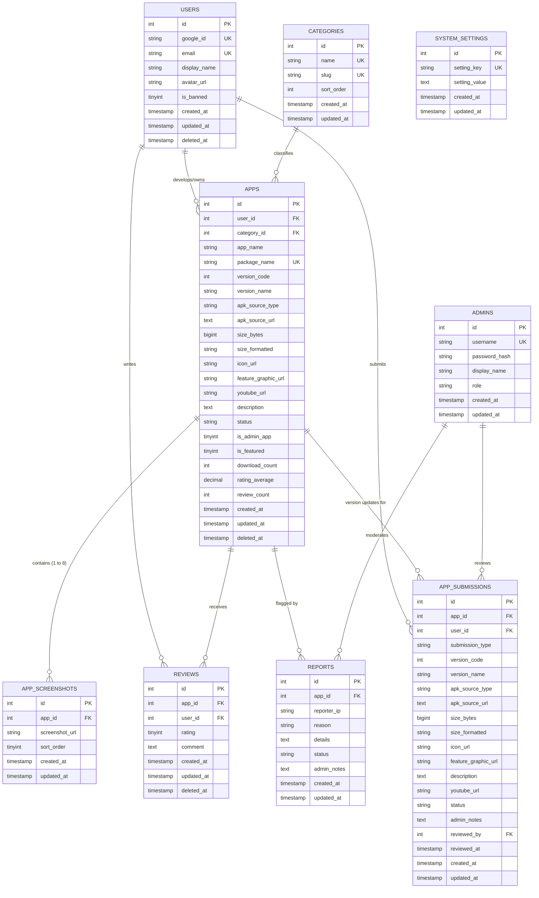

# Database Specification: DATABASE.md

**Document Version:** 1.0.0  
**Target Platform:** MySQL 5.7+ / MariaDB 10.3+ (phpMyAdmin Import-Ready)  
**Product Name:** SM Apx Store (Short: **Apx**)  
**Developer:** Shiva Miri  
**Tagline:** *"Discover. Download. Explore."*  
**Canonical References:** `PRD.md` (v1.1.0), `ARCHITECTURE.md` (v1.0.0)  

---

## 1. Overview & Architectural Design Decisions

### 1.1 Shared Hosting & phpMyAdmin Compatibility
To run reliably on free shared hosting (such as InfinityFree or standard cPanel stacks):
* **Storage Engine:** Strictly `ENGINE=InnoDB` across all tables for full transaction safety and foreign key referential integrity.
* **Character Set & Collation:** `utf8mb4` with `utf8mb4_unicode_ci` to support emojis and multilingual app descriptions without truncation.
* **No Privileged Routines:** Zero stored procedures, triggers, views, user-defined functions, or recurring events that are typically blocked or lack `SUPER` privileges on free shared MySQL instances.
* **Standard SQL Import:** The schema is packaged as standard DDL statements that can be imported directly into phpMyAdmin without syntax failures.

### 1.2 Table Inventory & Justifications
The database contains 8 focused tables structured to fulfill all requirements from `PRD.md` and `ARCHITECTURE.md`:
1. `users`: Stores Google OAuth authenticated public users and developers.
2. `admins`: Completely separate administrative credentials table (keeps administrative security out of user space).
3. `categories`: Normalized list of supported app categories, slug identifiers, and display ordering.
4. `apps`: Stores all published and submitted applications, version metadata, external CDN links, size attributes, and review metrics.
5. `app_submissions`: Dedicated queue table for version updates and submissions, enabling zero-downtime updates without breaking `package_name` uniqueness.
6. `app_screenshots`: Normalized store of 1 to 8 screenshot URLs per app.
7. `reviews`: One-review-per-user-per-app storage with ratings (1–5) and feedback comments.
8. `reports`: Community flag records for malicious packages, broken links, or misleading descriptions.
9. `system_settings`: Key-value storage for force update parameters (minimum version code, direct update link) and platform announcements.

---

## 2. Versioning & Zero-Downtime Update Tradeoff Analysis

### 2.1 The Architectural Challenge
`PRD.md` and `ARCHITECTURE.md` require:
1. `package_name` must be unique for public store indexing.
2. When a developer submits an update (higher `version_code`) for an already **Live** app, the current version must remain **Live and fully downloadable** until the new version is reviewed and approved by the admin.
3. Fast device-wide package matching for the native app's update scanner.

### 2.2 Selected Pattern: `apps` + `app_submissions` Queue
* **Option Evaluated A (Single Table with Compound Status Keys):** Store every update as a separate row in `apps`.
  * *Disadvantage:* `package_name` can no longer have a strict database-level `UNIQUE` constraint, complicating lookup speed, index cardinality, and foreign key relations from `reviews` and `reports`.
* **Option Evaluated B (Normalized `apps` + `app_versions` for all history):**
  * *Disadvantage:* Over-engineered for an MVP; requires two-table joins for every single public home screen shelf and detail lookup.
* **Chosen Solution: Two-Table Lifecycle (`apps` + `app_submissions`):**
  * `apps` holds the **active published state** of each application. `package_name` has a strict `UNIQUE` constraint for instantaneous index-driven lookups.
  * `app_submissions` holds pending submissions and updates (`submission_type`: `'new'` or `'update'`).
  * **When an update is submitted:** The existing record in `apps` continues serving users as `Live`. The update sits in `app_submissions` with status `'pending'`.
  * **On Admin Approval:** The admin approves the submission $	o$ a simple transaction writes the new `version_code`, `version_name`, `apk_source_url`, `size_bytes`, `size_formatted`, and media URLs directly into `apps`, while marking the submission row as `'approved'`.
  * **On Admin Rejection:** The row in `app_submissions` is marked `'rejected'` with an admin note; the live app in `apps` is untouched and continues serving users with zero downtime.

---

## 3. Soft Delete Strategy

Soft deletion (`deleted_at TIMESTAMP NULL DEFAULT NULL`) is applied only where preserving historical relationships and audit integrity is mandatory:

| Table | Soft Delete? | Rationale |
| :--- | :---: | :--- |
| `apps` | **YES** | If an app is removed or banned, reviews and abuse reports must not be orphaned or deleted. Allows admins to review past violations. |
| `users` | **YES** | Preserves user identity for submitted reviews and submitted apps even if a user account is deactivated or banned. |
| `reviews` | **YES** | Allows moderation of abusive reviews without breaking rating metric counts or foreign keys. |
| `reports` | **NO** | Hard resolution workflow managed via explicit `status` (`'pending'`, `'resolved'`, `'dismissed'`). |
| `app_submissions` | **NO** | Historical state is tracked directly via `status` (`'pending'`, `'approved'`, `'rejected'`). |
| `admins` | **NO** | Superadmin manages admin accounts directly; revoked admins are deleted or locked. |
| `categories` | **NO** | Static lookup data managed directly. |
| `app_screenshots`| **NO** | Cascadable asset metadata tied directly to the parent app. |

---

## 4. Entity-Relationship (ER) Diagram



---

## 5. Detailed Table Specifications & Schemas

### 5.1 `users`
Stores all end users and indie developers signing in via Google OAuth.

| Column | Type | Nullable | Default | Description |
| :--- | :--- | :---: | :---: | :--- |
| `id` | `INT UNSIGNED AUTO_INCREMENT` | NO | - | Primary Key |
| `google_id` | `VARCHAR(128)` | NO | - | Unique subject ID from Google OAuth |
| `email` | `VARCHAR(255)` | NO | - | Developer/User Gmail address |
| `display_name`| `VARCHAR(128)` | NO | - | Full name from Google profile |
| `avatar_url` | `VARCHAR(512)` | YES | NULL | Google account profile picture URL |
| `is_banned` | `TINYINT(1)` | NO | `0` | `1` = Banned by admin, `0` = Active |
| `created_at` | `TIMESTAMP` | NO | `CURRENT_TIMESTAMP` | Account creation timestamp |
| `updated_at` | `TIMESTAMP` | NO | `CURRENT_TIMESTAMP ON UPDATE CURRENT_TIMESTAMP` | Last profile update |
| `deleted_at` | `TIMESTAMP` | YES | NULL | Soft delete indicator |

* **Constraints:** `PRIMARY KEY (id)`, `UNIQUE KEY uq_users_google_id (google_id)`, `UNIQUE KEY uq_users_email (email)`.

---

### 5.2 `admins`
Isolated admin credentials for the desktop-only `/admin` control center. Kept strictly separate from public users.

| Column | Type | Nullable | Default | Description |
| :--- | :--- | :---: | :---: | :--- |
| `id` | `INT UNSIGNED AUTO_INCREMENT` | NO | - | Primary Key |
| `username` | `VARCHAR(64)` | NO | - | Unique login username |
| `password_hash`| `VARCHAR(255)` | NO | - | Secure `PASSWORD_BCRYPT` hash |
| `display_name`| `VARCHAR(128)` | NO | - | Admin screen display name |
| `role` | `VARCHAR(32)` | NO | `'admin'` | Role identifier (`superadmin`, `admin`) |
| `created_at` | `TIMESTAMP` | NO | `CURRENT_TIMESTAMP` | Creation timestamp |
| `updated_at` | `TIMESTAMP` | NO | `CURRENT_TIMESTAMP ON UPDATE CURRENT_TIMESTAMP` | Modification timestamp |

* **Constraints:** `PRIMARY KEY (id)`, `UNIQUE KEY uq_admins_username (username)`.

---

### 5.3 `categories`
Reference list for navigation shelves, filter pills, and search categorizations.

| Column | Type | Nullable | Default | Description |
| :--- | :--- | :---: | :---: | :--- |
| `id` | `INT UNSIGNED AUTO_INCREMENT` | NO | - | Primary Key |
| `name` | `VARCHAR(64)` | NO | - | Category title (e.g., Tools, Games) |
| `slug` | `VARCHAR(64)` | NO | - | URL-friendly slug (e.g., `tools`, `games`) |
| `sort_order` | `INT` | NO | `0` | Order of appearance in category chip bar |
| `created_at` | `TIMESTAMP` | NO | `CURRENT_TIMESTAMP` | Creation timestamp |
| `updated_at` | `TIMESTAMP` | NO | `CURRENT_TIMESTAMP ON UPDATE CURRENT_TIMESTAMP` | Update timestamp |

* **Constraints:** `PRIMARY KEY (id)`, `UNIQUE KEY uq_categories_slug (slug)`, `UNIQUE KEY uq_categories_name (name)`.

---

### 5.4 `apps`
The canonical live catalog. Holds active metadata, verified package identifiers, external CDN links, and precomputed review metrics.

| Column | Type | Nullable | Default | Description |
| :--- | :--- | :---: | :---: | :--- |
| `id` | `INT UNSIGNED AUTO_INCREMENT` | NO | - | Primary Key |
| `user_id` | `INT UNSIGNED` | YES | NULL | Owner developer (`NULL` if Admin direct post) |
| `category_id` | `INT UNSIGNED` | NO | - | Foreign Key to `categories` |
| `app_name` | `VARCHAR(128)` | NO | - | App title (3-50 chars) |
| `package_name`| `VARCHAR(191)` | NO | - | Unique Android package identifier |
| `version_code`| `INT UNSIGNED` | NO | - | Integer version code for update checks |
| `version_name`| `VARCHAR(32)` | NO | `'1.0.0'` | SemVer version string |
| `apk_source_type` | `ENUM('github', 'gdrive')` | NO | `'github'` | Source CDN provider type |
| `apk_source_url` | `TEXT` | NO | - | External public download URL |
| `size_bytes` | `BIGINT UNSIGNED` | NO | `0` | Size in exact bytes |
| `size_formatted` | `VARCHAR(32)` | NO | `'0 MB'` | Human-readable size (e.g., "18.4 MB") |
| `icon_url` | `VARCHAR(512)` | NO | - | App squircle icon URL |
| `feature_graphic_url` | `VARCHAR(512)` | NO | - | 16:9 banner graphic URL |
| `youtube_url`| `VARCHAR(255)` | YES | NULL | Optional trailer/demo YouTube URL |
| `description`| `TEXT` | NO | - | Detailed description and features |
| `status` | `ENUM('Live', 'Pending', 'In Review', 'Rejected', 'Banned')` | NO | `'Pending'` | Publication state |
| `is_admin_app`| `TINYINT(1)` | NO | `0` | `1` = Direct Admin app (`[Admin Verified]`) |
| `is_featured` | `TINYINT(1)` | NO | `0` | `1` = Promoted on Home Featured carousel |
| `download_count` | `INT UNSIGNED` | NO | `0` | Total recorded download button clicks |
| `rating_average` | `DECIMAL(3,2)` | NO | `0.00` | Precomputed average rating (0.00 to 5.00) |
| `review_count` | `INT UNSIGNED` | NO | `0` | Total approved reviews counter |
| `created_at` | `TIMESTAMP` | NO | `CURRENT_TIMESTAMP` | Creation timestamp |
| `updated_at` | `TIMESTAMP` | NO | `CURRENT_TIMESTAMP ON UPDATE CURRENT_TIMESTAMP` | Last updated timestamp |
| `deleted_at` | `TIMESTAMP` | YES | NULL | Soft delete indicator |

* **Constraints:** `PRIMARY KEY (id)`, `UNIQUE KEY uq_apps_package_name (package_name)`, `FOREIGN KEY (user_id) REFERENCES users(id) ON DELETE SET NULL`, `FOREIGN KEY (category_id) REFERENCES categories(id)`.

---

### 5.5 `app_submissions`
Moderation queue for new app submissions and version updates. Solves zero-downtime updates while maintaining `apps.package_name` uniqueness.

| Column | Type | Nullable | Default | Description |
| :--- | :--- | :---: | :---: | :--- |
| `id` | `INT UNSIGNED AUTO_INCREMENT` | NO | - | Primary Key |
| `app_id` | `INT UNSIGNED` | YES | NULL | Target app if update (`NULL` if brand new) |
| `user_id` | `INT UNSIGNED` | NO | - | Submitting developer |
| `submission_type` | `ENUM('new', 'update')` | NO | `'new'` | Whether it is a new app or version upgrade |
| `package_name`| `VARCHAR(191)` | NO | - | Intended Android package name |
| `app_name` | `VARCHAR(128)` | NO | - | App title |
| `category_id` | `INT UNSIGNED` | NO | - | Intended category |
| `version_code`| `INT UNSIGNED` | NO | - | New version code to be evaluated |
| `version_name`| `VARCHAR(32)` | NO | `'1.0.0'` | New version display name |
| `apk_source_type` | `ENUM('github', 'gdrive')` | NO | `'github'` | Binary host provider |
| `apk_source_url` | `TEXT` | NO | - | External release download link |
| `size_bytes` | `BIGINT UNSIGNED` | NO | `0` | Detected or manual size in bytes |
| `size_formatted` | `VARCHAR(32)` | NO | `'0 MB'` | Formatted size string |
| `icon_url` | `VARCHAR(512)` | NO | - | App icon URL |
| `feature_graphic_url` | `VARCHAR(512)` | NO | - | Feature banner URL |
| `description`| `TEXT` | NO | - | Description / Changelog notes |
| `youtube_url`| `VARCHAR(255)` | YES | NULL | Video link |
| `status` | `ENUM('pending', 'in_review', 'approved', 'rejected')` | NO | `'pending'` | Review queue status |
| `admin_notes`| `TEXT` | YES | NULL | Mandatory feedback note if rejected |
| `reviewed_by`| `INT UNSIGNED` | YES | NULL | Admin ID who reviewed the submission |
| `reviewed_at`| `TIMESTAMP` | YES | NULL | Approval or rejection timestamp |
| `created_at` | `TIMESTAMP` | NO | `CURRENT_TIMESTAMP` | Submission timestamp |
| `updated_at` | `TIMESTAMP` | NO | `CURRENT_TIMESTAMP ON UPDATE CURRENT_TIMESTAMP` | Update timestamp |

* **Constraints:** `PRIMARY KEY (id)`, `FOREIGN KEY (app_id) REFERENCES apps(id) ON DELETE CASCADE`, `FOREIGN KEY (user_id) REFERENCES users(id) ON DELETE CASCADE`, `FOREIGN KEY (reviewed_by) REFERENCES admins(id) ON DELETE SET NULL`.

---

### 5.6 `app_screenshots`
Stores normalized screenshot URLs (1 to 8 images per app) displayed in the app details gallery.

| Column | Type | Nullable | Default | Description |
| :--- | :--- | :---: | :---: | :--- |
| `id` | `INT UNSIGNED AUTO_INCREMENT` | NO | - | Primary Key |
| `app_id` | `INT UNSIGNED` | NO | - | Target application ID |
| `screenshot_url` | `VARCHAR(512)` | NO | - | Hosted HTTPS image URL |
| `sort_order` | `TINYINT UNSIGNED` | NO | `0` | Order of appearance (0 to 7) |
| `created_at` | `TIMESTAMP` | NO | `CURRENT_TIMESTAMP` | Record creation timestamp |
| `updated_at` | `TIMESTAMP` | NO | `CURRENT_TIMESTAMP ON UPDATE CURRENT_TIMESTAMP` | Last update |

* **Constraints:** `PRIMARY KEY (id)`, `FOREIGN KEY (app_id) REFERENCES apps(id) ON DELETE CASCADE`.

---

### 5.7 `reviews`
Stores user ratings and text reviews. Strictly enforced to 1 review per user per app.

| Column | Type | Nullable | Default | Description |
| :--- | :--- | :---: | :---: | :--- |
| `id` | `INT UNSIGNED AUTO_INCREMENT` | NO | - | Primary Key |
| `app_id` | `INT UNSIGNED` | NO | - | Reviewed application |
| `user_id` | `INT UNSIGNED` | NO | - | Review author |
| `rating` | `TINYINT UNSIGNED` | NO | - | Star rating (1 to 5) |
| `comment` | `TEXT` | NO | - | User written feedback |
| `created_at` | `TIMESTAMP` | NO | `CURRENT_TIMESTAMP` | Date written |
| `updated_at` | `TIMESTAMP` | NO | `CURRENT_TIMESTAMP ON UPDATE CURRENT_TIMESTAMP` | Date edited |
| `deleted_at` | `TIMESTAMP` | YES | NULL | Soft delete for moderation |

* **Constraints:** `PRIMARY KEY (id)`, `UNIQUE KEY uq_reviews_app_user (app_id, user_id)`, `FOREIGN KEY (app_id) REFERENCES apps(id) ON DELETE CASCADE`, `FOREIGN KEY (user_id) REFERENCES users(id) ON DELETE CASCADE`.

---

### 5.8 `reports`
Community abuse reports submitted against malicious apps, broken links, or inappropriate content.

| Column | Type | Nullable | Default | Description |
| :--- | :--- | :---: | :---: | :--- |
| `id` | `INT UNSIGNED AUTO_INCREMENT` | NO | - | Primary Key |
| `app_id` | `INT UNSIGNED` | NO | - | Flagged application |
| `reporter_ip`| `VARCHAR(45)` | NO | - | IPv4 / IPv6 of reporter for rate limiting |
| `reason` | `VARCHAR(255)` | NO | - | Short reason (Malware, Broken Link, Scam) |
| `details` | `TEXT` | YES | NULL | Elaborated feedback |
| `status` | `ENUM('pending', 'reviewed', 'dismissed')` | NO | `'pending'` | Moderation handling status |
| `admin_notes`| `TEXT` | YES | NULL | Action notes by reviewing admin |
| `created_at` | `TIMESTAMP` | NO | `CURRENT_TIMESTAMP` | Time reported |
| `updated_at` | `TIMESTAMP` | NO | `CURRENT_TIMESTAMP ON UPDATE CURRENT_TIMESTAMP` | Last updated |

* **Constraints:** `PRIMARY KEY (id)`, `FOREIGN KEY (app_id) REFERENCES apps(id) ON DELETE CASCADE`.

---

### 5.9 `system_settings`
Global key-value configuration storage for force updates and broadcast announcements.

| Column | Type | Nullable | Default | Description |
| :--- | :--- | :---: | :---: | :--- |
| `id` | `INT UNSIGNED AUTO_INCREMENT` | NO | - | Primary Key |
| `setting_key` | `VARCHAR(64)` | NO | - | Unique configuration identifier |
| `setting_value` | `TEXT` | NO | - | Serialized or plain string value |
| `created_at` | `TIMESTAMP` | NO | `CURRENT_TIMESTAMP` | Creation timestamp |
| `updated_at` | `TIMESTAMP` | NO | `CURRENT_TIMESTAMP ON UPDATE CURRENT_TIMESTAMP` | Modification timestamp |

* **Constraints:** `PRIMARY KEY (id)`, `UNIQUE KEY uq_settings_key (setting_key)`.

---

## 6. Query Optimization & Indexing Strategy

Free shared MySQL environments have limited CPU cycles. The schema defines targeted composite indexes for all high-volume queries:

### 6.1 Device-Wide Update Check Query
The native Android app sends all installed package names and version codes.
```sql
SELECT package_name, version_code, version_name, apk_source_url, size_formatted
FROM apps
WHERE package_name IN (?, ?, ...)
  AND status = 'Live'
  AND deleted_at IS NULL;
```
* **Dedicated Index:** `idx_apps_pkg_status (package_name, status, version_code, deleted_at)`
* *Benefit:* Covering index allows MySQL to resolve update comparisons directly from the index tree without table scanning.

### 6.2 Shelf Feeds (Home Screen)
```sql
-- Featured
SELECT * FROM apps WHERE status = 'Live' AND is_featured = 1 AND deleted_at IS NULL LIMIT 5;

-- New Arrivals
SELECT * FROM apps WHERE status = 'Live' AND deleted_at IS NULL ORDER BY created_at DESC LIMIT 10;

-- Top Rated
SELECT * FROM apps WHERE status = 'Live' AND deleted_at IS NULL ORDER BY rating_average DESC LIMIT 10;

-- Hot Today (Downloads)
SELECT * FROM apps WHERE status = 'Live' AND deleted_at IS NULL ORDER BY download_count DESC LIMIT 10;
```
* **Dedicated Indexes:**
  * `idx_apps_status_featured (status, is_featured, deleted_at)`
  * `idx_apps_status_created (status, deleted_at, created_at)`
  * `idx_apps_status_rating (status, deleted_at, rating_average)`
  * `idx_apps_status_downloads (status, deleted_at, download_count)`

### 6.3 3-Tier Search & Fallback Engine
Shared hosting environments frequently disable or lock InnoDB FULLTEXT parameters or minimum word lengths. To guarantee 100% reliability, search indexing uses both LIKE-friendly prefix indexes and InnoDB `FULLTEXT`:
* `FULLTEXT idx_apps_search (app_name, description)` (for broad token matching).
* `INDEX idx_apps_name (app_name)` (for fast prefix `app_name LIKE 'query%'`).
* `INDEX idx_apps_category_status (category_id, status, deleted_at)` (for Tier-2 category fallback lookups).

---

## 7. Application-Level Data Access Rules (PHP Layer)

Because MySQL does not provide native Row-Level Security (RLS) on shared hosting, security constraints are enforced at the Core PHP layer using prepared statements and session boundaries:

| Entity / Action | Public / Anonymous | Developer Owner | Superadmin / Admin |
| :--- | :--- | :--- | :--- |
| **View Catalog / App Details** | Allowed for `status = 'Live'` and `deleted_at IS NULL`. | Allowed for any of their own apps, regardless of status. | Full access to all records across all statuses. |
| **Download APK Link** | Allowed for Live apps. Server provides external URL. | Allowed for their own apps. | Allowed for moderation testing. |
| **Submit New App / Version** | Forbidden (redirects to Google Sign-In). | Allowed. Enforces `user_id = $_SESSION['user_id']`. | Allowed via direct admin upload (`is_admin_app = 1`). |
| **Edit Metadata** | Forbidden. | Allowed only for their own `app_submissions` rows with status `pending`. | Full update authority on all records. |
| **Write Review** | Forbidden (requires Google Sign-In). | Allowed on apps other than their own (cannot review own app). | Moderation / deletion authority. |
| **Approve / Reject / Ban** | Forbidden. | Forbidden. | Admin only via protected `$_SESSION['admin_logged_in']`. |

---

## 8. Complete Migration Script (Clean phpMyAdmin Import)

The SQL script below creates the entire database structure in the correct dependency order.

```sql
-- ============================================================================
-- SM Apx Store (Apx) - Complete Database Schema
-- Developer: Shiva Miri
-- Target: MySQL 5.7+ / MariaDB 10.3+ (phpMyAdmin Compatible)
-- Engine: InnoDB | Charset: utf8mb4 | Collation: utf8mb4_unicode_ci
-- ============================================================================

SET FOREIGN_KEY_CHECKS = 0;
SET SQL_MODE = "NO_AUTO_VALUE_ON_ZERO";
SET time_zone = "+00:00";

-- ----------------------------------------------------------------------------
-- 1. Table: users
-- ----------------------------------------------------------------------------
DROP TABLE IF EXISTS `users`;
CREATE TABLE `users` (
  `id` INT UNSIGNED NOT NULL AUTO_INCREMENT,
  `google_id` VARCHAR(128) NOT NULL,
  `email` VARCHAR(255) NOT NULL,
  `display_name` VARCHAR(128) NOT NULL,
  `avatar_url` VARCHAR(512) DEFAULT NULL,
  `is_banned` TINYINT(1) NOT NULL DEFAULT 0,
  `created_at` TIMESTAMP NOT NULL DEFAULT CURRENT_TIMESTAMP,
  `updated_at` TIMESTAMP NOT NULL DEFAULT CURRENT_TIMESTAMP ON UPDATE CURRENT_TIMESTAMP,
  `deleted_at` TIMESTAMP NULL DEFAULT NULL,
  PRIMARY KEY (`id`),
  UNIQUE KEY `uq_users_google_id` (`google_id`),
  UNIQUE KEY `uq_users_email` (`email`),
  INDEX `idx_users_banned` (`is_banned`, `deleted_at`)
) ENGINE=InnoDB DEFAULT CHARSET=utf8mb4 COLLATE=utf8mb4_unicode_ci;

-- ----------------------------------------------------------------------------
-- 2. Table: admins
-- ----------------------------------------------------------------------------
DROP TABLE IF EXISTS `admins`;
CREATE TABLE `admins` (
  `id` INT UNSIGNED NOT NULL AUTO_INCREMENT,
  `username` VARCHAR(64) NOT NULL,
  `password_hash` VARCHAR(255) NOT NULL,
  `display_name` VARCHAR(128) NOT NULL,
  `role` VARCHAR(32) NOT NULL DEFAULT 'admin',
  `created_at` TIMESTAMP NOT NULL DEFAULT CURRENT_TIMESTAMP,
  `updated_at` TIMESTAMP NOT NULL DEFAULT CURRENT_TIMESTAMP ON UPDATE CURRENT_TIMESTAMP,
  PRIMARY KEY (`id`),
  UNIQUE KEY `uq_admins_username` (`username`)
) ENGINE=InnoDB DEFAULT CHARSET=utf8mb4 COLLATE=utf8mb4_unicode_ci;

-- ----------------------------------------------------------------------------
-- 3. Table: categories
-- ----------------------------------------------------------------------------
DROP TABLE IF EXISTS `categories`;
CREATE TABLE `categories` (
  `id` INT UNSIGNED NOT NULL AUTO_INCREMENT,
  `name` VARCHAR(64) NOT NULL,
  `slug` VARCHAR(64) NOT NULL,
  `sort_order` INT NOT NULL DEFAULT 0,
  `created_at` TIMESTAMP NOT NULL DEFAULT CURRENT_TIMESTAMP,
  `updated_at` TIMESTAMP NOT NULL DEFAULT CURRENT_TIMESTAMP ON UPDATE CURRENT_TIMESTAMP,
  PRIMARY KEY (`id`),
  UNIQUE KEY `uq_categories_slug` (`slug`),
  UNIQUE KEY `uq_categories_name` (`name`),
  INDEX `idx_categories_order` (`sort_order`)
) ENGINE=InnoDB DEFAULT CHARSET=utf8mb4 COLLATE=utf8mb4_unicode_ci;

-- ----------------------------------------------------------------------------
-- 4. Table: apps
-- ----------------------------------------------------------------------------
DROP TABLE IF EXISTS `apps`;
CREATE TABLE `apps` (
  `id` INT UNSIGNED NOT NULL AUTO_INCREMENT,
  `user_id` INT UNSIGNED DEFAULT NULL,
  `category_id` INT UNSIGNED NOT NULL,
  `app_name` VARCHAR(128) NOT NULL,
  `package_name` VARCHAR(191) NOT NULL,
  `version_code` INT UNSIGNED NOT NULL,
  `version_name` VARCHAR(32) NOT NULL DEFAULT '1.0.0',
  `apk_source_type` ENUM('github', 'gdrive') NOT NULL DEFAULT 'github',
  `apk_source_url` TEXT NOT NULL,
  `size_bytes` BIGINT UNSIGNED NOT NULL DEFAULT 0,
  `size_formatted` VARCHAR(32) NOT NULL DEFAULT '0 MB',
  `icon_url` VARCHAR(512) NOT NULL,
  `feature_graphic_url` VARCHAR(512) NOT NULL,
  `youtube_url` VARCHAR(255) DEFAULT NULL,
  `description` TEXT NOT NULL,
  `status` ENUM('Live', 'Pending', 'In Review', 'Rejected', 'Banned') NOT NULL DEFAULT 'Pending',
  `is_admin_app` TINYINT(1) NOT NULL DEFAULT 0,
  `is_featured` TINYINT(1) NOT NULL DEFAULT 0,
  `download_count` INT UNSIGNED NOT NULL DEFAULT 0,
  `rating_average` DECIMAL(3,2) NOT NULL DEFAULT 0.00,
  `review_count` INT UNSIGNED NOT NULL DEFAULT 0,
  `created_at` TIMESTAMP NOT NULL DEFAULT CURRENT_TIMESTAMP,
  `updated_at` TIMESTAMP NOT NULL DEFAULT CURRENT_TIMESTAMP ON UPDATE CURRENT_TIMESTAMP,
  `deleted_at` TIMESTAMP NULL DEFAULT NULL,
  PRIMARY KEY (`id`),
  UNIQUE KEY `uq_apps_package_name` (`package_name`),
  INDEX `idx_apps_pkg_status` (`package_name`, `status`, `version_code`, `deleted_at`),
  INDEX `idx_apps_status_featured` (`status`, `is_featured`, `deleted_at`),
  INDEX `idx_apps_status_created` (`status`, `deleted_at`, `created_at`),
  INDEX `idx_apps_status_rating` (`status`, `deleted_at`, `rating_average`),
  INDEX `idx_apps_status_downloads` (`status`, `deleted_at`, `download_count`),
  INDEX `idx_apps_category_status` (`category_id`, `status`, `deleted_at`),
  INDEX `idx_apps_name` (`app_name`),
  FULLTEXT KEY `idx_apps_search` (`app_name`, `description`),
  CONSTRAINT `fk_apps_user` FOREIGN KEY (`user_id`) REFERENCES `users` (`id`) ON DELETE SET NULL,
  CONSTRAINT `fk_apps_category` FOREIGN KEY (`category_id`) REFERENCES `categories` (`id`)
) ENGINE=InnoDB DEFAULT CHARSET=utf8mb4 COLLATE=utf8mb4_unicode_ci;

-- ----------------------------------------------------------------------------
-- 5. Table: app_submissions
-- ----------------------------------------------------------------------------
DROP TABLE IF EXISTS `app_submissions`;
CREATE TABLE `app_submissions` (
  `id` INT UNSIGNED NOT NULL AUTO_INCREMENT,
  `app_id` INT UNSIGNED DEFAULT NULL,
  `user_id` INT UNSIGNED NOT NULL,
  `submission_type` ENUM('new', 'update') NOT NULL DEFAULT 'new',
  `package_name` VARCHAR(191) NOT NULL,
  `app_name` VARCHAR(128) NOT NULL,
  `category_id` INT UNSIGNED NOT NULL,
  `version_code` INT UNSIGNED NOT NULL,
  `version_name` VARCHAR(32) NOT NULL DEFAULT '1.0.0',
  `apk_source_type` ENUM('github', 'gdrive') NOT NULL DEFAULT 'github',
  `apk_source_url` TEXT NOT NULL,
  `size_bytes` BIGINT UNSIGNED NOT NULL DEFAULT 0,
  `size_formatted` VARCHAR(32) NOT NULL DEFAULT '0 MB',
  `icon_url` VARCHAR(512) NOT NULL,
  `feature_graphic_url` VARCHAR(512) NOT NULL,
  `description` TEXT NOT NULL,
  `youtube_url` VARCHAR(255) DEFAULT NULL,
  `status` ENUM('pending', 'in_review', 'approved', 'rejected') NOT NULL DEFAULT 'pending',
  `admin_notes` TEXT DEFAULT NULL,
  `reviewed_by` INT UNSIGNED DEFAULT NULL,
  `reviewed_at` TIMESTAMP NULL DEFAULT NULL,
  `created_at` TIMESTAMP NOT NULL DEFAULT CURRENT_TIMESTAMP,
  `updated_at` TIMESTAMP NOT NULL DEFAULT CURRENT_TIMESTAMP ON UPDATE CURRENT_TIMESTAMP,
  PRIMARY KEY (`id`),
  INDEX `idx_sub_user` (`user_id`, `status`),
  INDEX `idx_sub_status` (`status`, `created_at`),
  INDEX `idx_sub_app_id` (`app_id`),
  CONSTRAINT `fk_sub_app` FOREIGN KEY (`app_id`) REFERENCES `apps` (`id`) ON DELETE CASCADE,
  CONSTRAINT `fk_sub_user` FOREIGN KEY (`user_id`) REFERENCES `users` (`id`) ON DELETE CASCADE,
  CONSTRAINT `fk_sub_category` FOREIGN KEY (`category_id`) REFERENCES `categories` (`id`),
  CONSTRAINT `fk_sub_admin` FOREIGN KEY (`reviewed_by`) REFERENCES `admins` (`id`) ON DELETE SET NULL
) ENGINE=InnoDB DEFAULT CHARSET=utf8mb4 COLLATE=utf8mb4_unicode_ci;

-- ----------------------------------------------------------------------------
-- 6. Table: app_screenshots
-- ----------------------------------------------------------------------------
DROP TABLE IF EXISTS `app_screenshots`;
CREATE TABLE `app_screenshots` (
  `id` INT UNSIGNED NOT NULL AUTO_INCREMENT,
  `app_id` INT UNSIGNED NOT NULL,
  `screenshot_url` VARCHAR(512) NOT NULL,
  `sort_order` TINYINT UNSIGNED NOT NULL DEFAULT 0,
  `created_at` TIMESTAMP NOT NULL DEFAULT CURRENT_TIMESTAMP,
  `updated_at` TIMESTAMP NOT NULL DEFAULT CURRENT_TIMESTAMP ON UPDATE CURRENT_TIMESTAMP,
  PRIMARY KEY (`id`),
  INDEX `idx_screenshots_app_sort` (`app_id`, `sort_order`),
  CONSTRAINT `fk_screenshots_app` FOREIGN KEY (`app_id`) REFERENCES `apps` (`id`) ON DELETE CASCADE
) ENGINE=InnoDB DEFAULT CHARSET=utf8mb4 COLLATE=utf8mb4_unicode_ci;

-- ----------------------------------------------------------------------------
-- 7. Table: reviews
-- ----------------------------------------------------------------------------
DROP TABLE IF EXISTS `reviews`;
CREATE TABLE `reviews` (
  `id` INT UNSIGNED NOT NULL AUTO_INCREMENT,
  `app_id` INT UNSIGNED NOT NULL,
  `user_id` INT UNSIGNED NOT NULL,
  `rating` TINYINT UNSIGNED NOT NULL,
  `comment` TEXT NOT NULL,
  `created_at` TIMESTAMP NOT NULL DEFAULT CURRENT_TIMESTAMP,
  `updated_at` TIMESTAMP NOT NULL DEFAULT CURRENT_TIMESTAMP ON UPDATE CURRENT_TIMESTAMP,
  `deleted_at` TIMESTAMP NULL DEFAULT NULL,
  PRIMARY KEY (`id`),
  UNIQUE KEY `uq_reviews_app_user` (`app_id`, `user_id`),
  INDEX `idx_reviews_app_rating` (`app_id`, `rating`, `deleted_at`),
  CONSTRAINT `fk_reviews_app` FOREIGN KEY (`app_id`) REFERENCES `apps` (`id`) ON DELETE CASCADE,
  CONSTRAINT `fk_reviews_user` FOREIGN KEY (`user_id`) REFERENCES `users` (`id`) ON DELETE CASCADE
) ENGINE=InnoDB DEFAULT CHARSET=utf8mb4 COLLATE=utf8mb4_unicode_ci;

-- ----------------------------------------------------------------------------
-- 8. Table: reports
-- ----------------------------------------------------------------------------
DROP TABLE IF EXISTS `reports`;
CREATE TABLE `reports` (
  `id` INT UNSIGNED NOT NULL AUTO_INCREMENT,
  `app_id` INT UNSIGNED NOT NULL,
  `reporter_ip` VARCHAR(45) NOT NULL,
  `reason` VARCHAR(255) NOT NULL,
  `details` TEXT DEFAULT NULL,
  `status` ENUM('pending', 'reviewed', 'dismissed') NOT NULL DEFAULT 'pending',
  `admin_notes` TEXT DEFAULT NULL,
  `created_at` TIMESTAMP NOT NULL DEFAULT CURRENT_TIMESTAMP,
  `updated_at` TIMESTAMP NOT NULL DEFAULT CURRENT_TIMESTAMP ON UPDATE CURRENT_TIMESTAMP,
  PRIMARY KEY (`id`),
  INDEX `idx_reports_app_status` (`app_id`, `status`),
  CONSTRAINT `fk_reports_app` FOREIGN KEY (`app_id`) REFERENCES `apps` (`id`) ON DELETE CASCADE
) ENGINE=InnoDB DEFAULT CHARSET=utf8mb4 COLLATE=utf8mb4_unicode_ci;

-- ----------------------------------------------------------------------------
-- 9. Table: system_settings
-- ----------------------------------------------------------------------------
DROP TABLE IF EXISTS `system_settings`;
CREATE TABLE `system_settings` (
  `id` INT UNSIGNED NOT NULL AUTO_INCREMENT,
  `setting_key` VARCHAR(64) NOT NULL,
  `setting_value` TEXT NOT NULL,
  `created_at` TIMESTAMP NOT NULL DEFAULT CURRENT_TIMESTAMP,
  `updated_at` TIMESTAMP NOT NULL DEFAULT CURRENT_TIMESTAMP ON UPDATE CURRENT_TIMESTAMP,
  PRIMARY KEY (`id`),
  UNIQUE KEY `uq_settings_key` (`setting_key`)
) ENGINE=InnoDB DEFAULT CHARSET=utf8mb4 COLLATE=utf8mb4_unicode_ci;

SET FOREIGN_KEY_CHECKS = 1;
```

---

## 9. Seed Data (Development & Staging)

```sql
-- ============================================================================
-- Seed Data for SM Apx Store
-- ============================================================================

-- 1. Initial Admin User Placeholder (Password needs to be set via password_hash() in PHP)
-- Note: Replace with output of password_hash('YourAdminPassword', PASSWORD_BCRYPT)
INSERT INTO `admins` (`id`, `username`, `password_hash`, `display_name`, `role`) VALUES
(1, 'shivamiri', '$2y$10$placeholderForBcryptHashDoNotUseInProductionXXXXXXXXX', 'Shiva Miri', 'superadmin');

-- 2. System Settings (Client Force-Update Controls)
INSERT INTO `system_settings` (`setting_key`, `setting_value`) VALUES
('min_app_version_code', '1'),
('latest_app_version_code', '1'),
('update_apk_url', 'https://github.com/shivamiri/sm-apx-store/releases/download/v1.0.0/apx-store.apk'),
('force_update_message', 'A critical update is required to continue exploring and downloading apps seamlessly on SM Apx Store.'),
('announcement_banner', 'Welcome to SM Apx Store: Discover, Download, and Explore verified indie apps with zero friction!');

-- 3. Standard Categories
INSERT INTO `categories` (`id`, `name`, `slug`, `sort_order`) VALUES
(1, 'Tools', 'tools', 1),
(2, 'Games', 'games', 2),
(3, 'Productivity', 'productivity', 3),
(4, 'Media & Video', 'media', 4),
(5, 'Social', 'social', 5),
(6, 'Personalization', 'personalization', 6);

-- 4. Sample Public Developer User
INSERT INTO `users` (`id`, `google_id`, `email`, `display_name`, `avatar_url`, `is_banned`) VALUES
(1, 'google_oauth_109283746519283746510', 'developer.demo@gmail.com', 'Aarav Dev', 'https://images.unsplash.com/photo-1535713875002-d1d0cf377fde?w=150', 0);

-- 5. Sample Live Apps
INSERT INTO `apps` (`id`, `user_id`, `category_id`, `app_name`, `package_name`, `version_code`, `version_name`, `apk_source_type`, `apk_source_url`, `size_bytes`, `size_formatted`, `icon_url`, `feature_graphic_url`, `youtube_url`, `description`, `status`, `is_admin_app`, `is_featured`, `download_count`, `rating_average`, `review_count`) VALUES
(1, NULL, 1, 'SM Weather Ultra', 'com.shivamiri.weather', 5, '1.2.0', 'github', 'https://github.com/shivamiri/weather/releases/download/v1.2.0/weather-release.apk', 19293798, '18.4 MB', 'https://images.unsplash.com/photo-1592210454359-9043f067919b?w=256', 'https://images.unsplash.com/photo-1534088568595-a066f410bcda?w=1024', 'https://www.youtube.com/watch?v=dQw4w9WgXcQ', 'Real-time glassmorphic meteorological radar with hyper-local forecasts and lightning trackers.', 'Live', 1, 1, 1420, 4.80, 2),
(2, 1, 2, 'Pixel Dungeon Quest', 'com.aarav.pixeldungeon', 12, '2.1.0', 'github', 'https://github.com/aaravdev/pixelquest/releases/download/v2.1.0/game.apk', 45088768, '43.0 MB', 'https://images.unsplash.com/photo-1550745165-9bc0b252726f?w=256', 'https://images.unsplash.com/photo-1511512578047-dfb367046420?w=1024', NULL, 'Fast-paced rogue-like dungeon crawler designed for retro handhelds and mobile touchscreens.', 'Live', 0, 0, 890, 4.50, 1);

-- 6. Sample App Screenshots
INSERT INTO `app_screenshots` (`app_id`, `screenshot_url`, `sort_order`) VALUES
(1, 'https://images.unsplash.com/photo-1504608524841-42fe6f032b4b?w=600', 0),
(1, 'https://images.unsplash.com/photo-1561484930-998b6a7b22e8?w=600', 1),
(2, 'https://images.unsplash.com/photo-1542751371-adc38448a05e?w=600', 0);

-- 7. Sample Pending Submission (Brand New App Waiting for Admin Review)
INSERT INTO `app_submissions` (`id`, `app_id`, `user_id`, `submission_type`, `package_name`, `app_name`, `category_id`, `version_code`, `version_name`, `apk_source_type`, `apk_source_url`, `size_bytes`, `size_formatted`, `icon_url`, `feature_graphic_url`, `description`, `youtube_url`, `status`) VALUES
(1, NULL, 1, 'new', 'com.aarav.quicknotes', 'Quick Notes Pro', 3, 1, '1.0.0', 'gdrive', 'https://drive.google.com/uc?export=download&id=1BxzXxxSampleDriveFileID', 5242880, '5.0 MB', 'https://images.unsplash.com/photo-1517842645767-c639042777db?w=256', 'https://images.unsplash.com/photo-1499750310107-5fef28a66643?w=1024', 'Minimalist, distraction-free markdown note-taking utility with instant local caching.', NULL, 'pending');

-- 8. Sample Reviews
INSERT INTO `reviews` (`app_id`, `user_id`, `rating`, `comment`) VALUES
(1, 1, 5, 'Incredible glassmorphic interface and loads instantly without ads. Best weather utility on the store!'),
(2, 1, 4, 'Very fun mechanics, smooth frame rate. Please add controller support in the next update.');

-- 9. Sample Report
INSERT INTO `reports` (`app_id`, `reporter_ip`, `reason`, `details`, `status`) VALUES
(2, '192.168.1.45', 'False Version Display', 'The changelog specifies v2.1.0 but the internal app settings screen reports v2.0.9.', 'pending');
```

---

## 10. Sequential Migration & Import Order

When importing or executing migrations manually through phpMyAdmin or CLI, execute tables strictly in the order of foreign key dependency:

```
1. users             (Zero dependencies)
2. admins            (Zero dependencies)
3. categories        (Zero dependencies)
4. system_settings   (Zero dependencies)
5. apps              (Depends on users, categories)
6. app_submissions  (Depends on apps, users, categories, admins)
7. app_screenshots  (Depends on apps)
8. reviews          (Depends on apps, users)
9. reports          (Depends on apps)
```

---
*End of Database Specification. Preserved in repository root as `DATABASE.md`.*
